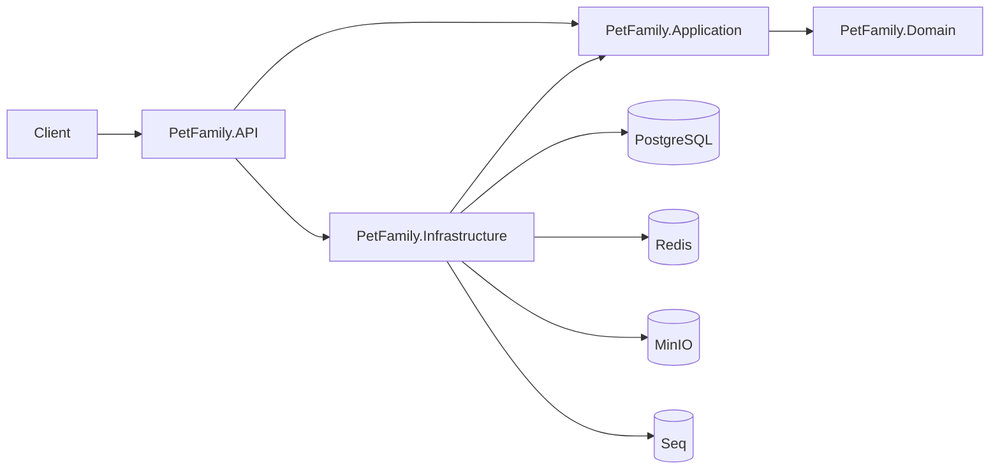

# 🐾 PetFamily — backend


Backend-платформа для волонтёров и питомцев: волонтёры ведут профили, добавляют животных, загружают фотографии, а пользователи просматривают питомцев и добавляют их в избранное.

Проект сделан как pet-проект по взрослым практикам: Clean Architecture, rich domain model, EF Core + Dapper, Redis, MinIO, JWT, структурное логирование и тесты.

---

## ✨ Возможности

- 👤 **Волонтёры**
  - создание, редактирование и soft delete;
  - соцсети и реквизиты для помощи;
  - подсчёт животных: нашли дом / ищут дом / на лечении.
- 🐶 **Питомцы**
  - создание и редактирование через волонтёра;
  - фотографии, реквизиты, статус помощи;
  - фильтрация, сортировка и пагинация;
  - soft delete.
- 📷 **Файлы**
  - загрузка фото в MinIO;
  - presigned URL для скачивания;
  - компенсация при сбое сохранения в БД.
- 🔐 **Аутентификация и авторизация**
  - JWT, роли `RegularUser`, `Volunteer`, `Admin`;
  - permissions и защита эндпоинтов;
  - хеширование паролей.
- ⭐ **Избранное**
  - User/Account, FavoritePet;
  - добавление и удаление питомца из избранного.
- ⚡ **Кэширование**
  - Redis для волонтёров и питомцев;
  - инвалидация после операций записи.
- 🧪 **Качество**
  - FluentValidation, единый Envelope;
  - Serilog + Seq, middleware исключений;
  - unit- и integration-тесты.

---

## 🏗 Архитектура



**Слои:**

| Слой | Ответственность |
|---|---|
| `Domain` | сущности, value objects, инварианты, доменные методы |
| `Application` | handler’ы, request-модели, валидаторы, интерфейсы |
| `Infrastructure` | EF Core, Dapper, Redis, MinIO, репозитории |
| `API` | контроллеры, DI, middleware, конфигурация |

**Почему EF Core + Dapper:** EF Core — для записи и доменной логики, Dapper — для быстрых read-моделей со сложными фильтрами и сортировкой.

---

## 🧰 Стек

| Категория | Технологии |
|---|---|
| Язык | C# 13, .NET 10 |
| Web | ASP.NET Core Web API, OpenAPI |
| Архитектура | Clean Architecture, SOLID, DDD-элементы, Result pattern |
| БД | PostgreSQL 18, EF Core 10, Dapper |
| Кэш | Redis |
| Файлы | MinIO (S3-совместимое хранилище) |
| Валидация | FluentValidation |
| Логирование | Serilog, Seq |
| Безопасность | JWT, роли, permissions |
| Тесты | xUnit, NSubstitute, Testcontainers |
| Инфраструктура | Docker Compose, user-secrets |

---

## 📁 Структура проекта

```text
PetFamily/
├── backend/
│   ├── src/
│   │   ├── PetFamily.API/
│   │   ├── PetFamily.Application/
│   │   ├── PetFamily.Domain/
│   │   └── PetFamily.Infrastructure/
│   ├── tests/
│   │   ├── PetFamily.UnitTests/
│   │   └── PetFamily.IntegrationTests/
│   ├── compose.yaml
│   └── backend.slnx
└── README.md
```

---

## 🚀 Быстрый старт

### Требования

- .NET 10 SDK
- Docker и Docker Compose
- `dotnet-ef`

```bash
dotnet tool install --global dotnet-ef
```

### 1. Поднять инфраструктуру

```bash
cd backend
docker compose up -d
```

Поднимутся:

| Сервис | Адрес |
|---|---|
| PostgreSQL | `localhost:5432` |
| Seq UI | http://localhost:8081 |
| MinIO API | http://localhost:9000 |
| MinIO Console | http://localhost:9001 |

### 2. Настроить секреты

```bash
cd src/PetFamily.API

dotnet user-secrets set "ConnectionStrings:Database" "Host=localhost;Port=5432;Database=pet_family;Username=postgres;Password=postgres"
dotnet user-secrets set "Seq:ServerUrl" "http://localhost:5341"
dotnet user-secrets set "Redis:ConnectionString" "localhost:6379"
dotnet user-secrets set "Minio:Endpoint" "localhost:9000"
dotnet user-secrets set "Minio:AccessKey" "minioadmin"
dotnet user-secrets set "Minio:SecretKey" "minioadmin"
dotnet user-secrets set "Jwt:SecretKey" "CHANGE_ME_TO_A_LONG_RANDOM_SECRET"
```

### 3. Применить миграции

```bash
cd ../..
dotnet ef database update \
  --project src/PetFamily.Infrastructure \
  --startup-project src/PetFamily.API
```

### 4. Запустить API

```bash
dotnet run --project src/PetFamily.API
```

OpenAPI: `http://localhost:5000/openapi/v1.json`

---

## ⚙️ Конфигурация

| Ключ | Назначение |
|---|---|
| `ConnectionStrings:Database` | подключение к PostgreSQL |
| `Seq:ServerUrl` | адрес Seq |
| `Redis:ConnectionString` | подключение к Redis |
| `Minio:Endpoint` | адрес MinIO |
| `Minio:AccessKey` | access key MinIO |
| `Minio:SecretKey` | secret key MinIO |
| `Minio:UseSsl` | использовать ли SSL |
| `Jwt:Issuer` | issuer токена |
| `Jwt:Audience` | audience токена |
| `Jwt:SecretKey` | секрет подписи JWT |
| `Jwt:ExpiryMinutes` | время жизни токена |

В `appsettings.json` лежат только заглушки, реальные значения — в user-secrets.

---

## 🔌 Основные эндпоинты

### Волонтёры

| Метод | Путь | Описание |
|---|---|---|
| `POST` | `/volunteers` | создать волонтёра |
| `GET` | `/volunteers?page=1&pageSize=10` | список с пагинацией |
| `GET` | `/volunteers/{id}` | волонтёр по ID |
| `PUT` | `/volunteers/{id}/main-info` | обновить основную информацию |
| `PUT` | `/volunteers/{id}/social-networks` | заменить соцсети |
| `PUT` | `/volunteers/{id}/donation-details` | заменить реквизиты |
| `DELETE` | `/volunteers/{id}` | soft delete |

### Питомцы

| Метод | Путь | Описание |
|---|---|---|
| `POST` | `/volunteers/{volunteerId}/pets` | создать питомца с фото |
| `PUT` | `/volunteers/{volunteerId}/pets/{petId}` | полное обновление |
| `DELETE` | `/volunteers/{volunteerId}/pets/{petId}` | soft delete |
| `GET` | `/pets` | список с фильтрами, сортировкой и пагинацией |
| `GET` | `/pets/{petId}` | питомец по ID |

### Аутентификация и избранное

| Метод | Путь | Описание |
|---|---|---|
| `POST` | `/auth/register` | регистрация пользователя |
| `POST` | `/auth/login` | вход, выдача JWT |
| `GET` | `/auth/me` | текущий пользователь |
| `GET` | `/favorites` | избранные питомцы |
| `POST` | `/favorites/{petId}` | добавить в избранное |
| `DELETE` | `/favorites/{petId}` | удалить из избранного |

### Сервисные

| Метод | Путь | Описание |
|---|---|---|
| `POST` | `/minio-test/upload` | тест загрузки файла |
| `GET` | `/minio-test/{bucket}/files` | список файлов |
| `GET` | `/minio-test/{bucket}/url/{*fileName}` | presigned URL |
| `DELETE` | `/minio-test/{bucket}/file/{*fileName}` | удалить файл |

---

## 🧠 Архитектурные решения

- **Result + Envelope.** Ожидаемые ошибки возвращаются через `Result`, клиент всегда получает единый JSON с `result`, `errorInfo`, `timeGenerated`.
- **EF Core + Dapper.** Запись идёт через EF Core и доменные методы, чтение — через Dapper и DTO.
- **Soft delete.** Используется `IsDeleted` + query filters; при удалении волонтёра каскадно помечаются его питомцы.
- **MinIO + компенсация.** Фото загружаются до сохранения в БД; при ошибке БД загруженные файлы удаляются.
- **Redis.** Кэшируются волонтёр по ID, питомец по ID и списки без фильтров; после записи кэш инвалидируется.
- **JWT + RBAC.** Роли и permissions проверяются через политики авторизации.
- **Логирование.** Serilog + Seq, структурные логи и логирование HTTP-запросов.

---

## 🧪 Тесты

```bash
# unit-тесты
dotnet test tests/PetFamily.UnitTests

# интеграционные тесты (нужен Docker)
dotnet test tests/PetFamily.IntegrationTests
```

Покрыто:

- value objects и доменные инварианты;
- подсчёт питомцев и soft delete;
- создание питомца с фото и компенсация ошибок;
- основные API-сценарии через Testcontainers.

---

## 🗺 Roadmap

- [ ] Frontend на React (отдельный репозиторий/этап).
- [ ] CI/CD pipeline.
- [ ] Health checks и метрики.
- [ ] Domain events и outbox.
- [ ] Расширение фильтров и сортировок.
